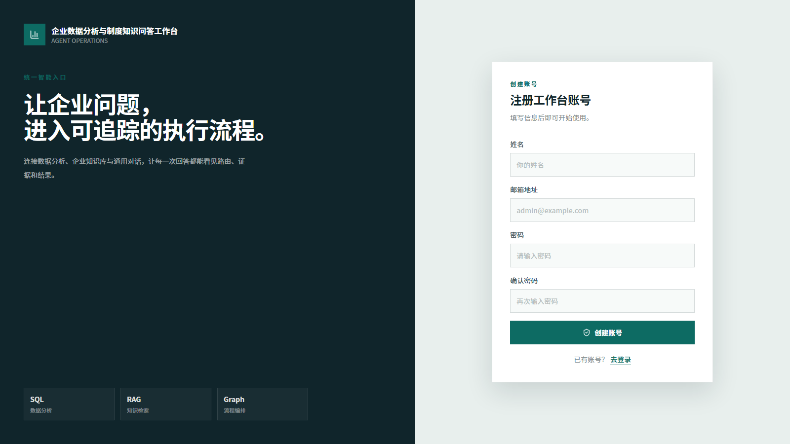
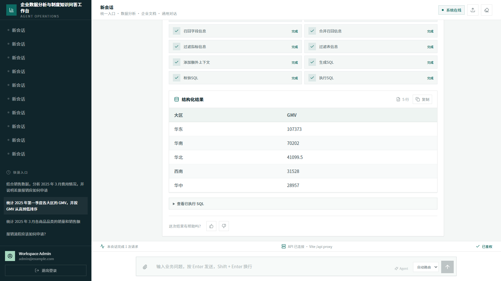
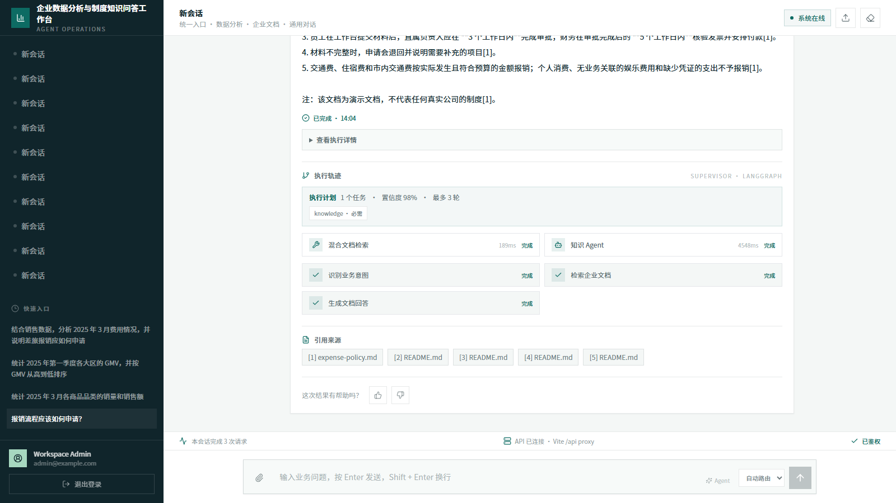
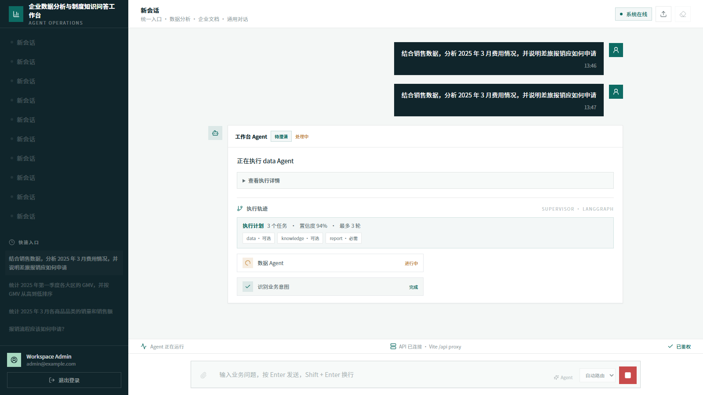
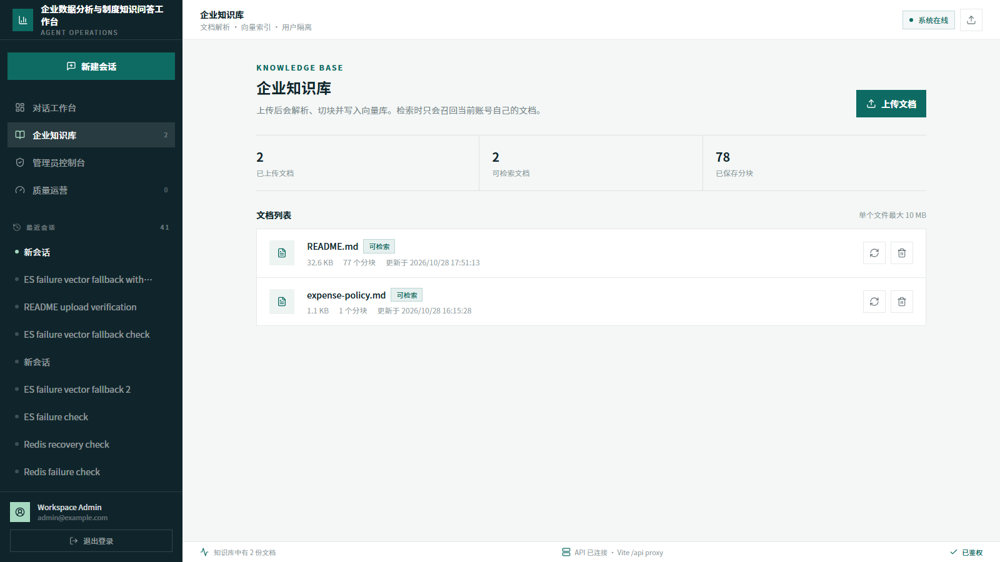
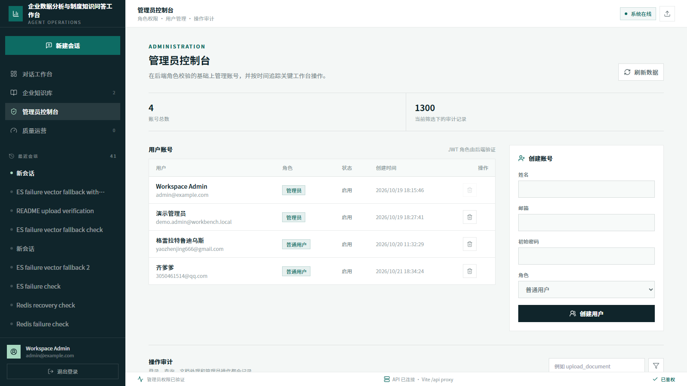
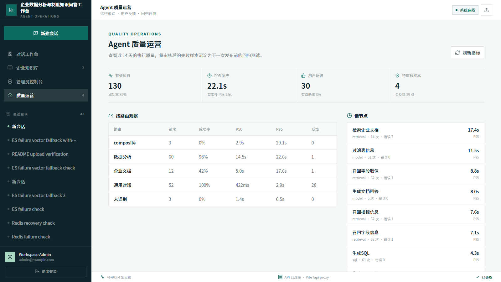

# 企业数据分析与制度知识问答工作台

面向企业经营数据分析与制度知识问答场景的全栈 AI 工作台。用户从统一聊天入口提问，系统按问题类型进入受限 NL2SQL、企业文档问答、通用对话或澄清流程，并通过 SSE 展示执行状态、数据结果和文档引用。

## 功能概览

- Supervisor 统一路由 Data、Knowledge、General 和 Report/Verifier Agent。
- Data Agent 使用 LangGraph 完成元数据召回、SQL 生成、校验、修正和只读执行。
- Knowledge Agent 使用 Qdrant 语义检索与 Elasticsearch BM25 检索，通过 RRF 融合，可选接入 BGE Reranker。
- 企业文档支持 PDF、DOCX、Markdown 和 TXT，回答必须引用本次检索到的文档来源。
- 任务、Agent 和工具均有白名单、超时、重试和调用预算；失败时返回部分结果或澄清，不伪造完整结论。
- MCP 工具支持内部鉴权和本地适配器降级；Redis 不可用时回退到有界进程内状态。
- SQLite 保存账号、会话、文档、审计和运行轨迹；长期记忆必须经过用户确认。
- React 工作台提供注册/登录、会话管理、知识库、Agent 轨迹、结果表格、引用、反馈和管理员控制台。

## 系统架构

~~~text
React / TypeScript / SSE
          |
          v
FastAPI Workbench
  |-- Supervisor -- ExecutionPlan -- budget / timeout / tool allowlist
  |     |-- Data Agent -- LangGraph -- read-only MySQL
  |     |-- Knowledge Agent -- Qdrant + Elasticsearch -- RRF -- citations
  |     |-- General Agent -- DeepSeek API
  |     `-- Report / Verifier -- structured evidence checks
  |-- MCP Tool Gateway -- remote MCP or local adapters
  |-- Runtime State -- Redis with in-process fallback
  `-- Quality Loop -- traces, feedback, reviewed regression cases

Docker Compose: MySQL / Qdrant / Elasticsearch / Kibana / TEI Embedding
                optional Redis / MCP / BGE Reranker / frontend
~~~

详细设计见 [docs/ARCHITECTURE.md](docs/ARCHITECTURE.md) 和 [docs/AGENT_DESIGN_AND_QUALITY_LOOP.md](docs/AGENT_DESIGN_AND_QUALITY_LOOP.md)。

## 界面预览

截图使用仓库内的合成数据和示例制度文档，不包含真实企业数据或账号信息。

### 注册入口

### 数据分析与 SQL 结果

### 制度知识检索与引用回答

### 多 Agent 流程与 SSE 状态

### 知识库管理

### 权限与审计

### 质量运营

## 快速启动：完整容器模式

以下命令适合下载项目后首次运行。需要安装 Git、Docker Desktop 或其他兼容 Docker Compose 的 Docker Engine，并准备一个可用的 DeepSeek API Key。

### 1. 获取代码并创建配置

~~~powershell
git clone https://github.com/yaozj-dev/enterprise-data-knowledge-workbench.git
cd enterprise-data-knowledge-workbench
Copy-Item .env.example .env
notepad .env
~~~

至少修改 .env 中这些值：

~~~dotenv
LLM_API_KEY=your_deepseek_api_key
APP_JWT_SECRET=replace_with_a_random_string_at_least_32_characters
APP_ADMIN_EMAIL=admin@example.com
APP_ADMIN_PASSWORD=replace_with_a_random_admin_password
MYSQL_ROOT_PASSWORD=replace_with_a_random_mysql_root_password
DB_META_PASSWORD=replace_with_a_random_meta_password
MYSQL_AGENT_READONLY_PASSWORD=replace_with_a_random_readonly_password
DB_DW_PASSWORD=replace_with_a_random_readonly_password
~~~

MYSQL_AGENT_READONLY_PASSWORD 和 DB_DW_PASSWORD 必须保持一致。不要把 .env、API Key、JWT 密钥或真实文档提交到 Git；.env、运行数据、日志和模型文件已加入忽略规则。

### 2. 准备 Embedding 模型

模型文件较大，不随 Git 仓库发布。先在项目根目录执行：

~~~powershell
uv sync --python 3.14
uv run hf download BAAI/bge-large-zh-v1.5 --local-dir "docker/embedding/bge-large-zh-v1.5"
~~~

Elasticsearch IK 插件会在镜像构建阶段下载并安装，因此首次构建需要网络访问；插件 ZIP 不需要提交到仓库。

### 3. 启动服务

~~~powershell
docker compose --env-file .env -f docker/docker-compose.yaml --profile full --profile state up -d --build
~~~

首次启动后构建元数据知识库：

~~~powershell
docker compose --env-file .env -f docker/docker-compose.yaml --profile full --profile state exec backend uv run python -m app.scripts.build_meta_knowledge -c conf/meta_config.yaml
~~~

打开：

- 工作台：<http://localhost:5173>
- 后端 API 文档：<http://localhost:8000/docs>
- Elasticsearch：<http://localhost:9200>
- Qdrant：<http://localhost:6333/dashboard>

新建应用数据库时，管理员账号由 .env 的 APP_ADMIN_EMAIL 和 APP_ADMIN_PASSWORD 初始化。普通用户也可以在登录页注册；注册账号固定为普通用户角色。

### 4. 日常管理

~~~powershell
# 查看服务和健康状态
docker compose --env-file .env -f docker/docker-compose.yaml --profile full --profile state ps

# 查看后端日志
docker compose --env-file .env -f docker/docker-compose.yaml --profile full --profile state logs -f backend

# 停止容器，保留数据卷
docker compose --env-file .env -f docker/docker-compose.yaml --profile full --profile state stop

# 下次开机后重新启动已有容器
docker compose --env-file .env -f docker/docker-compose.yaml --profile full --profile state start

# 删除容器但保留数据卷
docker compose --env-file .env -f docker/docker-compose.yaml --profile full --profile state down
~~~

不要随意执行 down -v；该命令会删除 MySQL、Qdrant、Elasticsearch、Redis 和应用数据卷。只有确认不再需要本地数据时才使用它。

## 宿主机开发模式

需要修改后端或前端代码时，可以只用 Docker 启动数据服务：

~~~powershell
docker compose --env-file .env -f docker/docker-compose.yaml up -d mysql qdrant elasticsearch kibana embedding

uv sync --python 3.14
uv run python -m app.scripts.build_meta_knowledge -c conf/meta_config.yaml
uv run fastapi dev main.py
~~~

另开一个终端启动前端：

~~~powershell
cd frontend
pnpm install
pnpm dev
~~~

宿主机模式默认访问 <http://localhost:5173>，前端开发服务器将 /api 转发到 http://127.0.0.1:8000。也可以使用启动脚本：

~~~powershell
./scripts/start-local.ps1 -Mode host
~~~

## 可选能力

### Redis 状态

完整容器模式加上 --profile state 会启动 Redis，并让运行状态使用 Redis；Redis 不可用时后端回退到有界进程内存。

### MCP 工具服务

完整容器模式会启动只暴露在 Docker 内网的 MCP 服务。配置随机的 MCP_SERVICE_TOKEN 后，网关才会使用远程 MCP；未配置时使用本地工具适配器。

### BGE Reranker

精排模型不随仓库发布。下载到 docker/reranker/bge-reranker-v2-m3 后再启动 ranking Profile：

~~~powershell
uv run hf download BAAI/bge-reranker-v2-m3 --local-dir "docker/reranker/bge-reranker-v2-m3"
$env:RERANKER_URL = "http://reranker:80/rerank"
docker compose --env-file .env -f docker/docker-compose.yaml --profile full --profile state --profile ranking up -d
~~~

Reranker 不可用时检索自动保留 RRF 结果，不会阻断文档问答。

## 测试与评测

后端单元测试和接口测试：

~~~powershell
uv run pytest -q
uv run ruff check app tests main.py
~~~

前端构建：

~~~powershell
cd frontend
pnpm install
pnpm run build
~~~

Compose 配置校验：

~~~powershell
docker compose --env-file .env -f docker/docker-compose.yaml --profile full --profile state config --quiet
~~~

离线评测数据位于 evals/，评测口径和限制见 [docs/EVALUATION.md](docs/EVALUATION.md)。本地合成数据结果不能外推为生产指标。

浏览器端到端测试需要在当前 PowerShell 进程提供测试账号：

~~~powershell
$env:E2E_ADMIN_EMAIL = "your-admin-email"
$env:E2E_ADMIN_PASSWORD = "your-admin-password"
$env:E2E_BASE_URL = "http://127.0.0.1:5173"
cd frontend
pnpm run test:e2e
~~~

## 目录结构

~~~text
enterprise-data-knowledge-workbench/
├── app/                    # FastAPI、Agent、MCP、服务和数据访问层
├── conf/                   # 应用和数仓元数据配置
├── docker/                 # Compose、MySQL 初始化和 Elasticsearch 构建文件
├── docs/                   # 架构、评测、基线和演示文档
├── evals/                  # 合成评测数据集
├── frontend/               # React + TypeScript 工作台
├── prompts/                # SQL 生成与校验 Prompt
├── scripts/                # 本地启动辅助脚本
├── tests/                  # 后端测试
├── main.py                 # FastAPI 入口
├── .env.example            # 配置模板，不含密钥
├── NOTICE.md               # 来源和许可证说明
└── pyproject.toml          # Python 项目配置
~~~

## 许可证

项目许可证和来源说明见 [LICENSE](LICENSE) 与 [NOTICE.md](NOTICE.md)。第三方模型、镜像、依赖和素材按照各自许可证使用。
