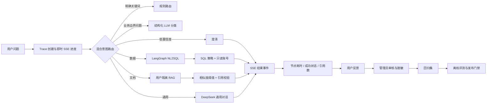

# Agent 设计与质量闭环

这份文档说明企业数据分析与制度知识问答工作台为什么这样设计、如何从运行数据中发现问题，以及一次优化如何安全地进入下一次发布。文档中的本地评测结果不代表线上生产指标。

## 1. 先定义业务问题，而不是先堆模型能力

企业内部用户的自然语言请求看似都在“聊天”，实际需要的证据、风险和执行权限完全不同：

| 用户目标 | 示例 | 主要风险 | 正确处理边界 |
| --- | --- | --- | --- |
| 看经营数据 | “本季度各区域销售额是多少？” | LLM 生成错误或危险 SQL | 只读 NL2SQL、表白名单、执行前校验 |
| 查企业制度 | “差旅报销需要哪些材料？” | 检索无关内容后产生幻觉 | 用户隔离 RAG、低相关性拒答、引用溯源 |
| 处理普通问题 | “什么是 Python 后端？” | 把开放问题误送到内部工具 | 通用模型，不声明企业事实 |
| 目标不清楚 | “帮我看一下这个情况” | 误查数据、误用文档 | 澄清目标、时间和对象 |

因此，项目不是将所有问题交给一个 Prompt，而是先建立**能力边界**。路由的价值不是炫技，而是在回答前确定：这次请求是否需要读数据库、是否需要企业证据、是否必须拒绝或追问。

## 2. Agent 架构与设计取舍



### 2.1 为什么是规则优先、结构化 LLM 兜底

纯规则的问题是覆盖不了“帮我看看本季度经营表现”这类业务表达；纯 LLM 路由的问题是每个请求都会多一次模型调用，带来成本、延迟和不可预测性。

当前策略分三层：

1. **明确路由**：销售、订单、GMV、制度、报销等高精度词直接进入对应能力，避免额外模型调用。
2. **边界路由**：命中“经营、预算、库存、部门、审批”等业务信号，但规则不能确认时，调用 DeepSeek 并强制输出 JSON：`intent + confidence`。
3. **安全回退**：JSON 不合法、模型不可用或置信度低于 `0.72` 时进入澄清，不把不确定性伪装成正确答案。

路由事件中持久化 `policy_version`、`strategy` 和 `confidence`。这样更新路由规则后，可以按版本比较错误率与 P95 延迟，而不是凭感觉说“新 Prompt 更好”。

### 2.2 为什么 NL2SQL 使用 LangGraph

数据分析不是一次模型调用：需要召回字段和指标、筛选表、生成 SQL、校验 SQL、有限修正、执行 SQL。LangGraph 将这些步骤显式表示为状态节点和受限边，适合表达失败重试和安全检查；LangChain 则负责统一模型与 Prompt 调用。

关键原则是：模型只提出 SQL 候选，程序和数据库决定它是否能执行。项目通过只读 MySQL 账号、语句白名单、危险关键字检查、`EXPLAIN`、超时和结果行数上限共同约束风险。

### 2.3 为什么 RAG 必须有“拒答”和“引用校验”

向量检索返回的是相似度，不是事实证明。当前链路在回答前做四层约束：

1. 上传时保留文件名、页码、用户 ID 和分块位置；Qdrant 查询强制按 `user_id` 过滤。
2. 低于 `RAG_MIN_RELEVANCE_SCORE` 的命中不进入 Prompt，防止用弱相关片段强行回答。
3. 去除重复 chunk，并将上下文限制为 `RAG_MAX_CONTEXT_CHARACTERS`，同时控制模型输入成本和延迟。
4. 回答必须包含落在本次召回编号范围内的 `[1]`、`[2]` 引用；没有可验证引用时返回澄清提示，而不输出无来源结论。

这不是完整的企业级事实核验系统，但将“检索到内容”和“允许输出结论”明确分开了。

### 2.4 为什么需要 Supervisor 和专业 Agent

单 Agent 加一组工具在简单问题上可以工作，但在“同时查销售数据和制度文档”时会把不同的证据、权限和失败策略混在同一个上下文中。当前 Supervisor 先生成 `ExecutionPlan`，再把任务交给 Data、Knowledge、General 或 Report Agent：

| Agent | 证据来源 | 工具边界 | 失败处理 |
| --- | --- | --- | --- |
| Data | 元数据与只读数仓 | 字段/指标召回、只读 SQL | SQL 校验失败或超时，保留错误状态 |
| Knowledge | 当前用户的文档片段 | 混合检索与引用 | 无足够证据时澄清，不猜制度 |
| General | DeepSeek 对话上下文 | 不访问企业数据工具 | 模型不可用时返回安全错误 |
| Report/Verifier | Data/Knowledge 的结构化结果 | 程序校验和证据合并 | 缺证据则 partial/clarified，不补造数字 |

计划 Schema 会限制任务数量、依赖图、工具白名单、超时和迭代上限；模型不能在计划中写入 `user_id`、数据库账号或权限。复合问题的 Data 和 Knowledge 任务可以并行，单个任务的 `timed_out` 不会抹掉另一个任务的结果。前端只展示状态和摘要，不暴露隐藏思维链。

### 2.5 MCP、Reranker 与降级边界

工具网关支持官方 MCP Python SDK 的 Streamable HTTP 传输，调用顺序是 `initialize → notifications/initialized → tools/list → tools/call`。服务端 Token、Host 校验和 Agent 白名单在协议层执行；MCP 返回值与本地适配器都转换成 `ToolResult`，因此远程服务不可用时可以降级而不改变 Agent 解析逻辑。

RAG 的默认主链路是 Qdrant + Elasticsearch BM25 召回后 RRF 融合；`RERANKER_URL` 配置后才启用 BGE Reranker。Reranker 故障回退到 RRF并写入降级标记，评测时必须分别报告向量、BM25、RRF 和 RRF+Reranker，不能只报最优路径。

## 3. 上线后数据闭环

一次请求完成并不代表 Agent 被优化。项目将运行过程沉淀为以下数据：

| 数据层 | 保存内容 | 用途 | 隐私边界 |
| --- | --- | --- | --- |
| `agent_runs` | 路由、策略版本、首事件耗时、总耗时、检索/模型/SQL 阶段耗时、状态、引用数 | 看成功率和性能分布 | 问题摘要会脱敏邮箱、手机号和常见密钥格式 |
| `agent_run_steps` | 每个节点的名称、类别、开始偏移、耗时、状态 | 定位 P95 慢节点和失败阶段 | 不保存节点 Prompt 或完整模型输出 |
| `agent_feedback` | 点赞/点踩、问题分类、用户补充说明 | 发现用户感知质量问题 | 只能评价本人执行记录 |
| `regression_cases` | 管理员审核后的脱敏问题、期望路由 | 作为后续离线回归集 | 只有审核通过后才能进入 |

管理员质量页可看到：请求量、成功率、首事件 P95、总响应 P50/P95、按路由拆分的质量指标、慢节点和待审核反馈。普通用户只能在自己的回答下提交反馈，不能看到别人的运行记录或运营数据。

### 3.1 指标如何用于优化中间节点

| 观察到的信号 | 可能原因 | 优化动作 | 验证方法 |
| --- | --- | --- | --- |
| `识别业务意图` P95 偏高 | 过多问题进入 LLM 路由 | 收紧边界词、提升明确规则覆盖、缓存低风险静态意图 | 按策略版本比较路由耗时和误路由反馈 |
| `检索企业文档` 慢或点踩多 | 分块不合理、Embedding 服务慢、阈值不合适 | 调整 chunk 大小/重叠、批量索引、检查 TEI、引入 reranker | Top-K 命中率、引用准确率、检索节点 P95 |
| SQL 节点慢或失败 | 元数据召回不足、SQL 复杂、表设计问题 | 加强指标描述、限制聚合规模、优化索引、收紧超时 | 固定 SQL 结果集、错误类型和 SQL 阶段耗时 |
| 负反馈集中于路由 | 业务表达未覆盖 | 管理员标注期望路由，导出回归集后调整规则或分类 Prompt | 新旧策略在回归集上的混淆矩阵 |
| 反馈“回答不正确” | RAG 证据不足、Prompt 未约束、数据语义歧义 | 回放 Trace、核对引用、补充文档或元数据 | 人工核验、引用准确率、通过后再发布 |
| 复合任务经常 partial | 某一子 Agent 超时、工具服务不稳定或证据不足 | 按 Agent/工具维度拆分 P95，调整超时、召回 Top-K 或降级策略 | 子任务成功率、部分结果可用率、澄清率 |
| MCP 工具失败 | 握手、Host、Token、Schema 或业务处理器错误 | 区分协议错误与业务错误，验证 `tools/list` 与 `ToolResult` 契约 | MCP 成功率、`TOOL_NOT_ALLOWED`、`TOOL_TIMEOUT` 比例 |

## 4. 响应性能策略

性能不只看“总耗时”，还要看用户多久看到系统已经在处理。项目记录两个不同指标：

- **TTFE（time to first event）**：从请求进入到首个有效 SSE 事件的时间。路由前立即输出“识别业务意图”进度，避免用户面对空白等待。
- **总响应 P50/P95**：P50 代表典型体验，P95 代表长尾体验，不能只报平均值掩盖慢请求。

当前已实现的优化策略：

- 明确意图不经过额外的路由模型；仅边界业务表达使用结构化 LLM 分类。
- 会话历史限制为最近 8 条、总长 4,000 字符，避免多轮对话无限增加 Token。
- RAG 上下文有固定上限，低相关与重复 chunk 不进入模型。
- 数据、文档、模型和 SQL 阶段分别计时，性能排查不依赖猜测。
- SSE 按节点返回进度，接口失败在流内返回安全错误，而不是暴露数据库或供应商细节。
- 复合任务按 Agent 并行计时，报告阶段只接收结构化证据；一个子 Agent 超时可以让用户先看到另一个来源的结果。
- 报告生成、Verifier 和修正调用分别设置超时与输出上限；程序校验通过但 Verifier 服务超时时，回答保留并记录降级原因，不让一次辅助模型超时抹掉已经核验的证据。

尚未实现但适合后续演进的生产优化包括：Embedding 批处理队列、语义缓存、模型并发限流、分布式 Trace、异步任务队列和缓存命中率指标。这些内容不属于当前默认部署能力。

## 5. 什么叫“自迭代”，什么不叫

可信的自迭代不是让模型根据一次点踩自动改 Prompt、自动更新生产规则。那会将错误样本、提示注入和偶然偏好直接放大到所有用户。

本项目的受控迭代流程是：

1. 用户对具体 Trace 提交反馈。
2. 管理员查看路由、节点耗时、引用数量和错误类型，判断问题是数据、检索、路由还是产品预期。
3. 管理员将确认有效的样本脱敏，并标注期望路由后纳入回归集。
4. 使用 `export_regression_cases` 导出 JSONL，再运行路由、RAG、SQL 评测与单元测试。
5. 修改 Prompt、规则、阈值或模型配置时递增策略版本，灰度或本地验证后比较新旧指标。
6. 只有离线基准不回退、安全测试通过、人工审查完成后才发布；指标恶化时按策略版本回滚。

因此，项目的“自进化”是**数据驱动、可审计、可回滚的人在回路优化**，不是不可控的在线自我修改。

## 6. 可复现命令

在项目根目录的 PowerShell 中执行：

```powershell
# 导出管理员审核通过的、已经脱敏的反馈样本
uv run python -m app.scripts.export_regression_cases

# 将固定基准和新增反馈样本一起回归路由
uv run python -m app.scripts.evaluate_router `
  --regression-path "logs\feedback_regression_cases.jsonl"

# 生成不改动任何线上策略的质量建议报告
uv run python -m app.scripts.quality_loop_report --window-days 14

# 完整基础回归
uv run pytest -q
uv run ruff check app tests
```

日志目录位于 `.gitignore` 中，不会把用户反馈、运行 Trace 或本地评测报告提交到仓库。
