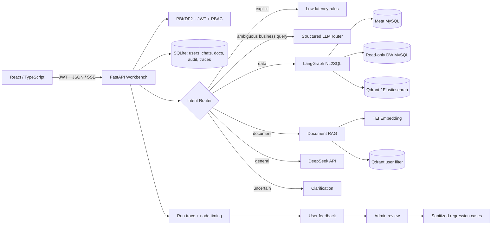
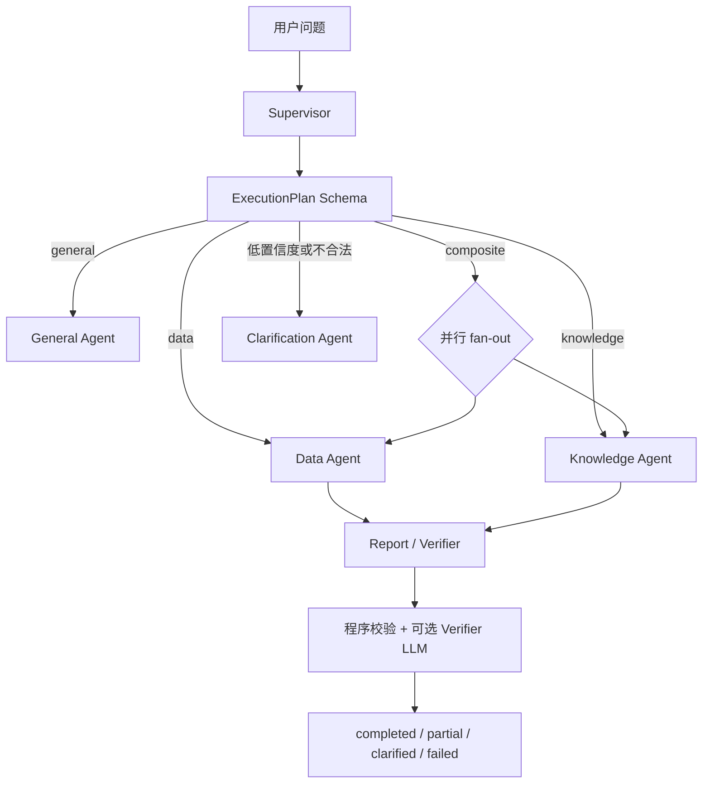

# 架构说明

## 系统边界

企业数据分析与制度知识问答工作台把三个不同风险等级的问题放在同一个入口中：

1. 数据分析问题进入受限的 NL2SQL 图，只能读取演示数仓。
2. 企业制度问题进入用户隔离的文档 RAG，回答必须带引用。
3. 开放问题进入 DeepSeek 通用对话，未知短问题要求用户补充信息。



## Supervisor 多智能体编排

当前实现由 supervisor_graph 先生成服务端基线计划并再次校验；对复合请求可选调用结构化 LLM 规划器。模型只能修改任务目标，不能改变意图、Agent 集合、工具白名单、身份边界或预算；非法输出最多修正一次，仍失败就回退基线。Data Agent 已通过结构化 AgentResult 接口接入 Supervisor，Knowledge 和 General Agent 也在 Supervisor 边界返回相同契约。SSE 只负责向浏览器传输安全事件，旧的流式适配器保留用于回滚和旧集成。

切换编排器使用环境变量 AGENT_ORCHESTRATOR_MODE：supervisor 是默认模式，legacy 会使用兼容路由；未知值始终回退到 supervisor。这个开关便于在升级过程中比较行为并快速回滚，旧模式不会作为最终演示路径。

Supervisor 先根据规则路由生成 `ExecutionPlan`，再选择一个专业 Agent 或拆分复合任务。计划模型包含 `intent`、`tasks`、`required_evidence`、`confidence` 和 `max_iterations`；每个任务包含 Agent、目标、依赖、工具白名单、是否必需和超时。Pydantic 校验会拒绝未知 Agent、未知工具、超过 3 个任务、循环依赖以及任何用户身份或数据库权限字段。`SUPERVISOR_PLANNER_MODE=hybrid`（默认）只对复合请求启用模型规划；`deterministic` 可在离线或故障场景关闭。模型规划超时、JSON 不合法或违反语义约束时最多修正一次，然后回退到服务端基线计划。



### 为什么不使用一个 Agent 加所有工具

数据分析和企业文档问答的证据来源、权限边界和失败策略不同。让一个循环同时生成 SQL、检索制度并总结报告，会扩大工具权限，也难以判断错误来自路由、SQL、检索还是生成。拆分后，Data Agent 只能走只读数仓链路，Knowledge Agent 只能读取当前用户的文档，Report Agent 只接收结构化证据；Supervisor 负责边界和状态，不把模型输出当作权限。

任务状态统一为 `planned → running → succeeded / failed / timed_out / partial / skipped`；整体状态为 `planned → executing → verifying → completed / partial / clarified / failed / cancelled`。复合任务中一个 Agent 超时会保留另一个 Agent 的结果；必需证据缺失时不输出完整结论，非必需失败时明确返回部分结果。

## 有界工具循环

知识 Agent 已接入受限的 Action/Observation 执行器：模型只能从服务端白名单选择工具，服务端覆盖查询和身份参数；工具超时或可重试失败最多重试一次，普通重复参数直接拒绝。一次 Supervisor 执行最多 3 个阶段、全局最多 6 次调用，非法 Agent 只允许一次服务端重规划，仍不匹配就澄清。Data Agent 的 LangGraph 节点继续使用固定、可审计的 SQL 工具链。SSE 只发送 Agent、实际工具调用、状态、耗时和摘要，不发送原始 Thought、系统 Prompt 或完整敏感参数。

## RAG 检索链路

文档查询按以下顺序执行：

```text
Qdrant Top-20 + Elasticsearch BM25 Top-20
                    ↓
               RRF(k=60)
                    ↓
        可选 BGE Reranker（RERANKER_URL）
                    ↓
          阈值过滤 / 动态截断 / Top-5
```

当前 RRF 已接入主链路，Reranker 是 HTTP 可选适配器；Compose 使用 TEI `cpu-1.9`、float32 和单候选请求以控制 CPU 服务稳定性，没有配置或服务异常时明确标记 `reranker_unavailable` 并返回 RRF 结果。本机 30 条合成问题中，RRF+Reranker Top-3 命中率和引用准确率均为 `100%`，但 P50/P95 延迟约 `4.33s/4.78s`，所以默认部署仍优先使用 RRF。Qdrant 与 Elasticsearch 查询都带当前用户过滤，引用保存文档 ID、文件名、页码、chunk 序号和内容指纹。该评测不代表真实企业文档准确率。

## MCP 与降级

`app/mcp/sdk_server.py` 使用官方 MCP Python SDK 的 `FastMCP.streamable_http_app()`。主 API 兼容入口挂载于 `/internal/mcp-sdk/mcp`；完整 Compose 模式还单独运行 `app.mcp.server`，只在 Docker 内网暴露 `http://mcp:8000/mcp`。SDK Session Manager 的 lifespan 在两种部署方式中都会启动。网关依次完成 `initialize`、`notifications/initialized`、`tools/list` 和 `tools/call`，工具调用结果统一转换为 `ToolResult`。内部 Token、Host 校验和注册表白名单在协议边界执行；未授权工具返回 `CallToolResult.isError=true` 与 `TOOL_NOT_ALLOWED`。原有 `/internal/mcp` 兼容端点保留用于轻量部署和回归测试。

SDK 注册表提供稳定的工具 Schema，并在服务 lifespan 阶段绑定文档检索、数据目录、只读 SQL、已确认记忆、候选记忆和证据校验处理器。未配置服务 Token 时 Gateway 不尝试远程调用；远程服务超时或不可用时，文档/证据工具回退到本地适配器，其他已注册业务工具回退到进程内注册表。不同路径都返回相同的 `ToolResult` 契约。

## Redis、LangGraph 与长期记忆的边界

- **LangGraph State**：单次问数图内部的节点输入、召回结果、SQL 候选和执行结果，随图执行合并。
- **Redis**：跨 HTTP 请求的运行状态、SSE 轨迹和有限恢复上下文，Key 为 `agent:{user_id}:{conversation_id}:{run_id}`，有 TTL 和事件数量上限；不替代图内 State。
- Redis 只保存脱敏的计划摘要和执行元数据，不保存原始回答、SQL、Prompt、完整工具参数或文档片段；不可用时使用有界进程内后备并向 SSE 发出 `degraded`。
- **MySQL 长期记忆**：只保存用户确认后的摘要、偏好和明确事实；模型只能提出候选，确认、删除和审计都由服务端完成。

每次认证请求只读取当前用户已确认的记忆，最多 8 条、总计约 2,000 字符；内容作为明确标记的不可信个性化上下文提供给通用回答、文档回答和综合报告，不进入 SQL 生成，也不能充当企业证据或覆盖安全规则。记忆库不可用时跳过个性化上下文，当前回答继续执行，并通过 `degraded` 事件告知前端；Redis 运行状态也有独立的内存后备实现。

## 一次请求怎样执行

### 数据分析

1. 路由将销售、订单、GMV 等问题送入数据 Agent。
2. LangGraph 先抽取关键词，同时从 Qdrant 召回字段/指标、从 Elasticsearch 召回枚举取值。
3. 图合并上下文，筛选候选表与指标，调用模型生成 SQL。
4. 生成 SQL 必须经过只读语句、表白名单、单语句、危险关键字检查和数据库 `EXPLAIN`。
5. 校验失败最多修正两次；仍失败时拒绝执行。成功结果通过 SSE 返回执行轨迹、结果表和实际 SQL。

### 文档问答

1. 上传文件后，后端解析 PDF/DOCX/Markdown/TXT，优先按本地 tokenizer 的实际 token 数切块并保持单块不超过模型上限；tokenizer 不可用时使用 420 字符硬上限兜底。
2. 每个分块通过有界批次调用 Embedding 后写入 Qdrant，payload 中保存 `user_id`、文档 ID、文件名、页码、切片序号和内容指纹；重建索引后会同步实际切片记录。
3. 查询时 Qdrant 强制加上当前 `user_id` 过滤条件，向量库层面不会召回别人的分块。
4. 低于相似度阈值和重复的分块不会进入 Prompt；上下文有字符上限，避免弱相关内容和超长输入。
5. 模型只能使用检索片段回答，结论后必须输出 `[1]` 类引用；后端会校验引用编号必须属于本次召回，否则拒绝输出未经溯源的结论。

### 会话上下文

会话消息存到 SQLite，但并非无限送入模型。后端仅取当前用户拥有的会话中最近 8 条消息，且总长度限制 4,000 字符；历史只用于理解“它”“刚才那个制度”等指代，不能覆盖系统规则或成为制度事实。

用户确认的长期记忆与会话历史分开读取，并按用户 ID 二次校验、状态过滤和长度截断。知识 Agent 仍必须只引用当前检索到的文档，记忆内容不会被当成制度来源。

## 关键设计取舍

| 决策 | 原因 | 实现边界 |
| --- | --- | --- |
| SQLite 保存应用数据 | 账号、会话、审计是新应用数据，不污染上游演示 MySQL | 先降低部署与迁移成本，后续可替换为 PostgreSQL |
| MySQL 只读数仓 | 大模型生成 SQL 不能接触写库权限 | 白名单、`EXPLAIN`、超时、行数上限和只读账号共同降低风险 |
| Qdrant payload 过滤 | 仅在应用层过滤可能因代码遗漏造成跨用户泄漏 | 把 `user_id` 作为向量查询 filter 的硬条件 |
| SSE 而非轮询 | LangGraph 包含多步召回、生成与执行 | 浏览器能实时显示节点状态，连接与实现成本低于 WebSocket |
| 混合路由 | 明确问题要低延迟，边界业务问题需要语义判断 | 规则先覆盖高置信度表达；仅模糊业务问题使用结构化 LLM JSON 分类，低置信度回退澄清 |
| 有界历史 | 多轮体验与成本、注入风险之间平衡 | 限制条数和长度，并把历史声明为非权威上下文 |
| Trace + 人工审核闭环 | 单次回答无法说明真实质量，也不能让模型自行改生产策略 | 每次请求记录阶段耗时和策略版本；点踩样本经审核、脱敏后进入回归集，离线评测通过才发布 |
| Verifier 降级可见 | 第二个模型不是可信根，模型不可用时不能伪装成完整成功 | 程序硬校验先行；Verifier 仅以结构化高置信度 `pass/revise/block` 辅助，低置信度和不可用都显式标记 `partial` |

## 安全与可观测性

- PBKDF2-SHA256 加盐哈希密码，不保存明文密码。
- JWT 使用 HMAC-SHA256 签名；旧 `/api/query` 兼容接口也必须鉴权。
- 自助注册由 `APP_ALLOW_SELF_REGISTRATION` 控制，服务端固定新账号为 `user` 角色，不能由前端传入 `admin`；公网场景应在接入邀请、邮箱验证、限流或 SSO 前关闭注册。
- 管理员路由使用后端 `require_admin` 依赖，前端隐藏按钮不是唯一权限控制。
- 管理员删除账号时先通过文档服务清理该账号在 Qdrant 的向量，再删除 SQLite 用户；数据库会级联清除其会话和文档，审计记录保留但不再关联已删除账号。
- 数据 Agent 通过独立的 `agent_readonly` MySQL 账号访问 `dw`；`verify_readonly_dw_access` 会用应用的异步连接校验实际账号、授权和读查询，避免仅凭配置文件判断权限生效。
- 文档内容通过 SHA-256 查重；删除时先清除 Qdrant 向量，再删除 SQLite 文档和分块。
- 每个 HTTP 响应返回 `X-Request-ID`；设置 `APP_LOG_JSON=true` 后文件日志可供采集系统按请求、状态码和耗时检索。
- 业务审计记录登录、查询、文档变更和管理员操作，管理员可分页查看和按操作类型筛选。
- Agent Trace 将路由策略、首事件耗时、总耗时、检索/模型/SQL 阶段耗时、状态和引用数存入独立表；问题摘要会对邮箱、手机号和常见密钥格式脱敏，默认保留 90 天，可通过 `QUALITY_TRACE_RETENTION_DAYS` 调整。
- 普通用户只能对自己的 Trace 提交反馈。管理员审核后才能将脱敏问题写入回归集；系统只生成质量建议，不在线自动改写 Prompt、规则或模型配置。

## 评测如何解释

| 评测 | 数据集 | 当前结果 | 不能说明什么 |
| --- | --- | --- | --- |
| 路由评测 | 40 条固定中文问题，含 10 条待澄清问题 | 40/40，100% | 不能替代真实用户长尾问题 |
| RAG 检索与引用 | 10 篇合成制度、30 条问题 | Top-3 检索 100%，Top-1 引用 100% | 不代表真实企业文档效果 |
| SQL 结果评测 | 30 条固定演示数仓问题，按行级结果比对 | 本轮 30/30，且全部通过安全 SQL 检查 | 合成演示数据集，不能外推为真实业务或生产准确率 |
| Supervisor 合同与工具安全 | 单元测试覆盖计划 Schema、循环依赖、工具预算、MCP 握手和未授权调用 | 当前测试套件通过 | 不等于线上多租户压测或真实 MCP 集群可用性 |

完整的设计原因、运行指标和闭环流程见 [AGENT_DESIGN_AND_QUALITY_LOOP.md](AGENT_DESIGN_AND_QUALITY_LOOP.md)。
